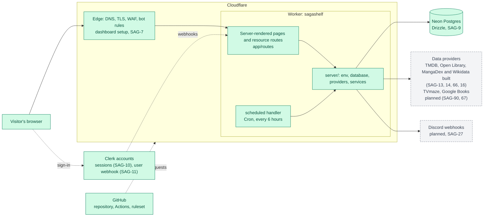
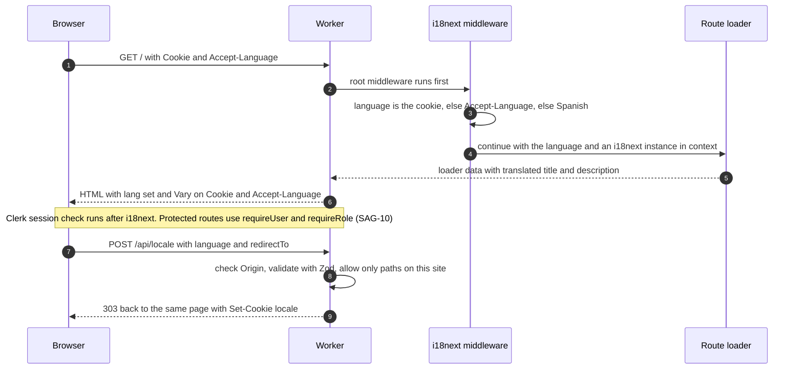
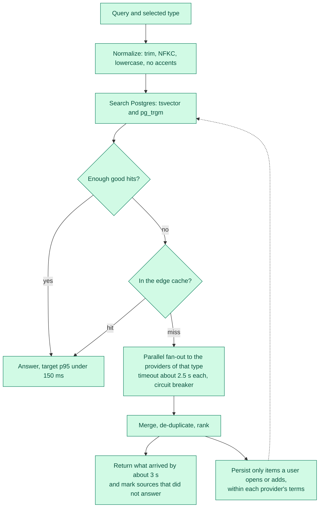
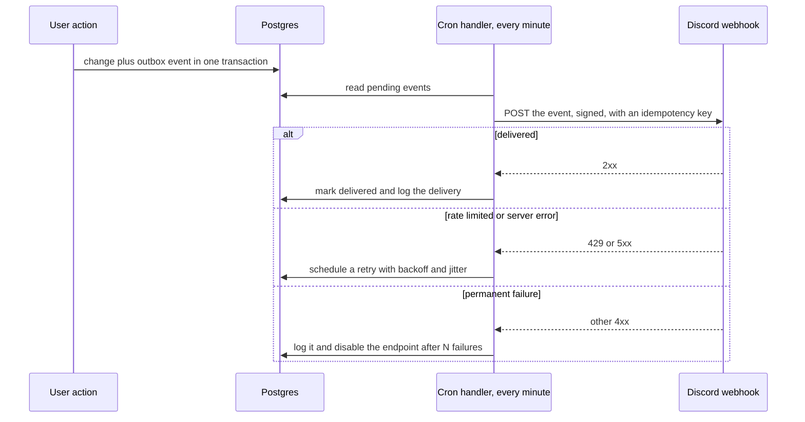
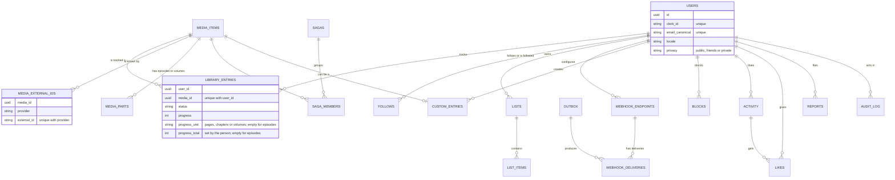
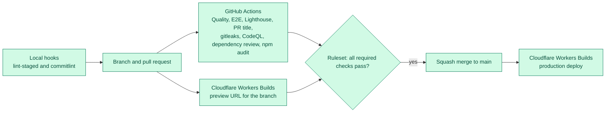

# Architecture

SagaShelf is one full-stack app: server-rendered pages, API routes and webhooks in a single Cloudflare Worker, backed by Postgres and a few third-party services. This page is the overview. The reasons behind each choice are in the [decision records](adr/README.md).

## Legend

Green boxes exist today. Gray dashed boxes are designed and ticketed but not built yet.

## 1. System overview

The Worker serves the pages (search, title pages, the sagas and their curation screen for the administrator, the library, the statistics, the settings, sign-in and the legal pages), the image proxy, `/api/health`, `/api/locale` and the Clerk webhook, and adds security headers (including a CSP with a nonce for pages) to every response. The edge settings are steps in the dashboard ([edge setup](edge-setup.md), [ADR-011](adr/011-edge-security-and-domain.md)). `server/` holds the validated environment module, the database, the providers, the search and the jobs. TMDB (movies, series and anime), Open Library (books) and MangaDex (manga) are the data providers built; the last two are switched on by a variable. Wikidata is not a provider of titles: a job looks each title up and keeps which other formats of the same story it has ([ADR-025](adr/025-wikidata.md), SAG-16, switched on by `WIKIDATA_ENABLED`). The others are planned. The `scheduled` handler has two Cron Triggers: the first runs every 6 hours and refreshes the titles that are close to the 6 months TMDB allows ([ADR-007](adr/007-background-work-cron-and-outbox.md), SAG-54), then looks up to 20 titles up in Wikidata and brings the curated sagas into the database ([ADR-026](adr/026-sagas.md), SAG-25), and the second, half an hour later, asks TVmaze for the next episode of the series ([ADR-027](adr/027-tvmaze-next-episode.md), SAG-90, switched on by `TVMAZE_ENABLED`); the outbox that would need it every minute is still planned.

## 2. Life of a request

See [ADR-008](adr/008-i18n-spanish-default.md) for the language rules and [ADR-006](adr/006-security-model.md) for the checks applied to every state-changing route.

## 3. Search pipeline (built for TMDB, see [ADR-004](adr/004-search-strategy.md))

Providers by type: movies, series and anime use TMDB. Books use Open Library with Google Books as a fallback. Manga uses MangaDex plus the book providers. Details and the constraints that come from each provider's terms are in [ADR-004](adr/004-search-strategy.md) and [ADR-005](adr/005-providers-and-licensing.md).

## 4. Outbox and outgoing webhooks (planned)

See [ADR-007](adr/007-background-work-cron-and-outbox.md).

## 5. Data model

All 20 tables of SAG-9 exist: users, the catalog, sagas, the library, lists and custom titles, social, moderation, and the outbox and webhook tables. Analytics tables arrive with SAG-24. Only the main tables and relations are drawn; the full list and the rules their constraints enforce are in [ADR-002](adr/002-data-postgres-neon-drizzle.md).

## 6. From a change to production

See [ADR-010](adr/010-ci-cd-and-repository-rules.md).

## Environments

| Environment | Where                                  | `APP_ENV`     | Notes                                                      |
| ----------- | -------------------------------------- | ------------- | ---------------------------------------------------------- |
| Local       | `npm run dev`, <http://localhost:5173> | `production`* | Create `.dev.vars` with `APP_ENV=development` to change it |
| Preview     | One URL per branch from Workers Builds | `preview`     | Publicly reachable for now                                 |
| Production  | <https://sagashelf.app>                | `production`  | `www` redirects to the apex domain (SAG-7)                 |

\* The default value comes from `wrangler.jsonc`. Nothing reads `APP_ENV` yet.

## Limits that shape the design

These are Cloudflare Workers Free plan limits read on 2026-10-20 (see [ADR-001](adr/001-runtime-react-router-on-workers.md)):

- 10 ms of CPU time per HTTP request and per Cron Trigger invocation
- 50 subrequests per invocation, and Cache API calls count toward it
- 5 Cron Triggers per account, and `waitUntil()` work can run for up to 30 seconds after the response

## Three things to know when writing end-to-end tests

Found while stabilizing the flaky tests (SAG-53, 2026-10-27; SAG-69, 2026-10-28; SAG-72, 2026-10-29). The e2e tests run the production build on Miniflare, the local copy of the Workers runtime.

- **The local rate limiter counts in windows fixed to the clock.** Miniflare resets the count at every minute (it was read in `miniflare/dist/src/workers/ratelimit/ratelimit-object.worker.js`), unlike the edge, which is only eventually consistent. A burst can fall in two windows, so a test of a limit of N must send `2N + 1` requests: in at most two windows, one of them gets more than N. A burst of `1.5N` passed or failed depending on the second of the minute in which it ran.
- **An answer given before the body of a POST is read breaks the connection to Miniflare.** The next requests answer 500 (`TypeError: fetch failed`). The CI has no Clerk keys, so every POST to an account route is refused before its body is read. `requireUser` calls `drainBody` (`server/http/body.ts`) before it refuses, and an action that answers early for another reason (a rate limit, a body too big) reads the body first, as `answerWithoutReading` does in several routes. That fixed the routes of ours, but not the refusals given **before** our code runs: React Router refuses a form with a foreign `Origin` on its own. So the Worker entry (`workers/app.ts`) now wraps the whole handler in `answerAndDrain` (`server/http/drain-after.ts`), which reads and drops the body that is left, whatever answered (SAG-69). `e2e/connection.spec.ts` keeps it: it sends a refused POST and a GET over **one** connection, which failed every time before the fix, whereas a test that opens its own connections fails only now and then. On the edge none of this has any effect, so it was invisible in production.
- **Each run is its own caller for the rate limiters.** The limiters count per `CF-Connecting-IP`, which Cloudflare sets at the edge and no test sent, so every test was the same caller, "unknown", and two runs within a minute shared the budget of 60 searches. Six short runs in a row of `e2e/search.spec.ts` failed in two of them with a 429 (seen as `Cache-Control: private` instead of `private, no-store`); twelve repetitions in one run failed 41 tests. `playwright.config.ts` now makes one caller per run (`E2E_CALLER`, kept in the environment so the workers share it) and sends it as `extraHTTPHeaders`. A header that a test writes itself wins, as the burst test does with its own caller. After the change, fourteen short runs in a row had no 429, and two full runs in a row passed. Repeating a test many times **inside one run** still shares that run's budget (`--repeat-each` above about 5 on the search tests), and starting and stopping the preview server many times in a few seconds can refuse a connection once in a while.

## Folder map

| Path                            | What lives there                                                                          |
| ------------------------------- | ----------------------------------------------------------------------------------------- |
| `app/routes`                    | Pages and resource routes (`api.*`, `webhooks.*`), declared in `app/routes.ts`            |
| `app/components`, `app/lib`     | Code that is safe for the browser. Lint forbids importing `server/` here                  |
| `app/locales`, `app/middleware` | UI text in Spanish and English, and the per-request language selection                    |
| `server/`                       | Environment, database, providers, services and jobs. Never imported by the browser bundle |
| `server/testing`                | The shared MSW mock server used by all tests                                              |
| `workers/app.ts`                | The Worker entry with the `fetch` and `scheduled` handlers                                |
| `e2e`                           | Playwright tests                                                                          |
| `docs`                          | This page and the decision records                                                        |
