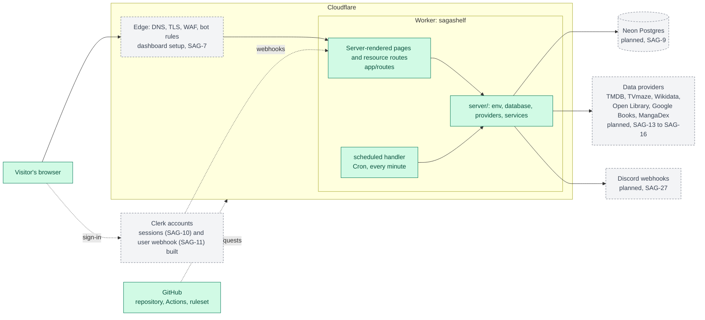
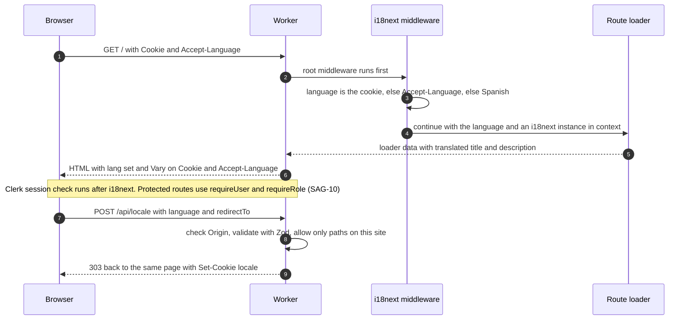
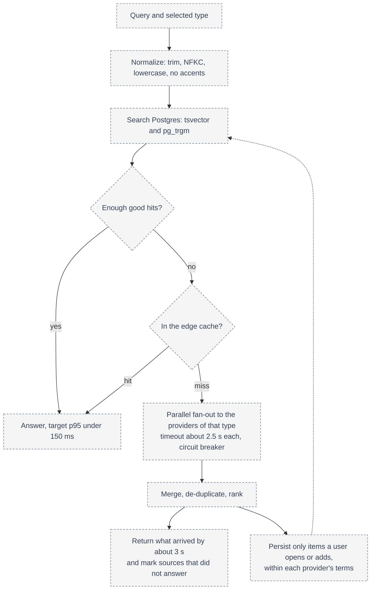
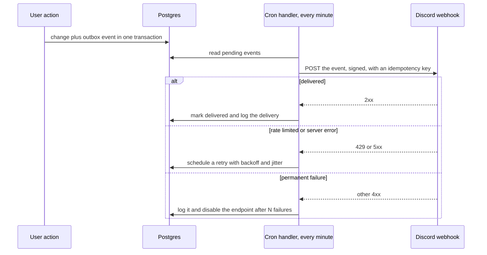
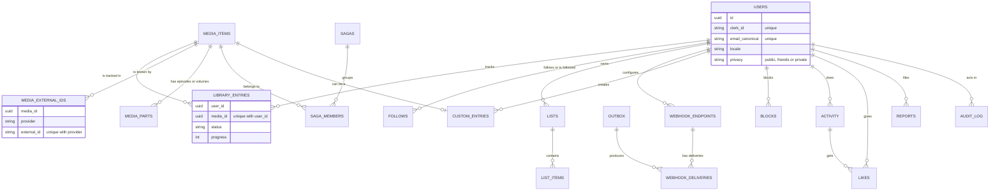
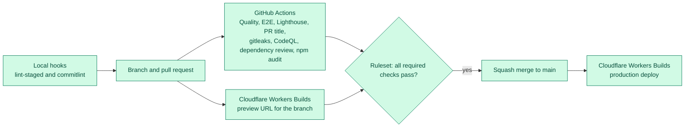

# Architecture

SagaShelf is one full-stack app: server-rendered pages, API routes and webhooks in a single Cloudflare Worker, backed by Postgres and a few third-party services. This page is the overview. The reasons behind each choice are in the [decision records](adr/README.md).

## Legend

Green boxes exist today. Gray dashed boxes are designed and ticketed but not built yet.

## 1. System overview

Today the Worker serves the home page, the 404 and error pages, `/api/health` and `/api/locale`, and adds security headers (including a CSP with a nonce for pages) to every response. The edge settings are steps in the dashboard ([edge setup](edge-setup.md), [ADR-011](adr/011-edge-security-and-domain.md)). `server/` holds the validated environment module. The `scheduled` handler exists and does nothing yet.

## 2. Life of a request

See [ADR-008](adr/008-i18n-spanish-default.md) for the language rules and [ADR-006](adr/006-security-model.md) for the checks applied to every state-changing route.

## 3. Search pipeline (planned)

Providers by type: movies, series and anime use TMDB. Books use Open Library with Google Books as a fallback. Manga uses MangaDex plus the book providers. Details and the constraints that come from each provider's terms are in [ADR-004](adr/004-search-strategy.md) and [ADR-005](adr/005-providers-and-licensing.md).

## 4. Outbox and outgoing webhooks (planned)

See [ADR-007](adr/007-background-work-cron-and-outbox.md).

## 5. Data model

All 20 tables of SAG-9 exist: users, the catalog, sagas, the library, lists and custom titles, social, moderation, and the outbox and webhook tables. Analytics tables arrive with SAG-24. Only the main tables and relations are drawn; the full list and the rules their constraints enforce are in [ADR-002](adr/002-data-postgres-neon-drizzle.md).

## 6. From a change to production

See [ADR-010](adr/010-ci-cd-and-repository-rules.md).

## Environments

| Environment | Where                                  | `APP_ENV`     | Notes                                                      |
| ----------- | -------------------------------------- | ------------- | ---------------------------------------------------------- |
| Local       | `npm run dev`, <http://localhost:5173> | `production`* | Create `.dev.vars` with `APP_ENV=development` to change it |
| Preview     | One URL per branch from Workers Builds | `preview`     | Publicly reachable for now                                 |
| Production  | `sagashelf.moyfdzz.workers.dev`        | `production`  | A custom domain is planned (SAG-7)                         |

\* The default value comes from `wrangler.jsonc`. Nothing reads `APP_ENV` yet.

## Limits that shape the design

These are Cloudflare Workers Free plan limits read on 2026-10-20 (see [ADR-001](adr/001-runtime-react-router-on-workers.md)):

- 10 ms of CPU time per HTTP request and per Cron Trigger invocation
- 50 subrequests per invocation, and Cache API calls count toward it
- 5 Cron Triggers per account, and `waitUntil()` work can run for up to 30 seconds after the response

## Two things to know when writing end-to-end tests

Found while stabilizing the flaky tests (SAG-53, 2026-10-27). The e2e tests run the production build on Miniflare, the local copy of the Workers runtime.

- **The local rate limiter counts in windows fixed to the clock.** Miniflare resets the count at every minute (it was read in `miniflare/dist/src/workers/ratelimit/ratelimit-object.worker.js`), unlike the edge, which is only eventually consistent. A burst can fall in two windows, so a test of a limit of N must send `2N + 1` requests: in at most two windows, one of them gets more than N. A burst of `1.5N` passed or failed depending on the second of the minute in which it ran.
- **An answer given before the body of a POST is read breaks the connection to Miniflare.** The next requests answer 500 (`TypeError: fetch failed`). The CI has no Clerk keys, so every POST to an account route is refused before its body is read. `requireUser` now calls `drainBody` (`server/http/body.ts`) before it refuses; an action that answers early for another reason (an `Origin` that does not match, a rate limit, a body too big) must read the body first, as `answerWithoutReading` does in several routes. On the edge this has no effect, so it was invisible in production.

## Folder map

| Path                            | What lives there                                                                          |
| ------------------------------- | ----------------------------------------------------------------------------------------- |
| `app/routes`                    | Pages and resource routes (`api.*`, `webhooks.*`), declared in `app/routes.ts`            |
| `app/components`, `app/lib`     | Code that is safe for the browser. Lint forbids importing `server/` here                  |
| `app/locales`, `app/middleware` | UI text in Spanish and English, and the per-request language selection                    |
| `server/`                       | Environment, database, providers, services and jobs. Never imported by the browser bundle |
| `server/testing`                | The shared MSW mock server used by all tests                                              |
| `workers/app.ts`                | The Worker entry with the `fetch` and `scheduled` handlers                                |
| `e2e`                           | Playwright tests                                                                          |
| `docs`                          | This page and the decision records                                                        |
